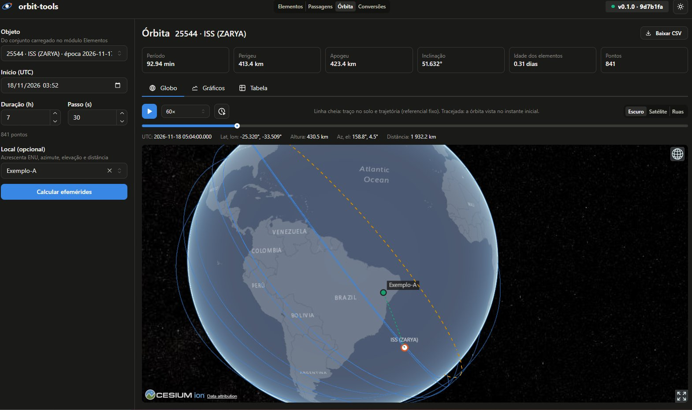

# orbit-tools

**Em produção:** [orbittracking.duckdns.org](https://www.orbittracking.duckdns.org/), para usar direto no navegador, sem instalar nada.

> **English.** Live instance: [orbittracking.duckdns.org](https://www.orbittracking.duckdns.org/). orbit-tools is an open source web application for satellite orbit propagation (SGP4), sensor pass prediction, generation of tracking trajectories for radars, and coordinate conversions (geodetic, ECEF, ENU, azimuth/elevation/range). It fetches orbital elements from Celestrak or Space-Track, finds passes over a user-defined sensor, helps select which objects to track, and exports trajectory files at the sensor's sampling rate. Backend in Python (FastAPI, numpy, sgp4), frontend in React. The interface and documentation are in Portuguese. MIT license.

Aplicação web de propagação de órbita, passagens sobre sensores, geração de trajetórias para rastreio e conversão de coordenadas. Unifica e substitui os apps [TrajectoryOrbitPropag](https://github.com/francisvalguedes/TrajectoryOrbitPropag) e [trajectory-coordinate-converter](https://github.com/francisvalguedes/trajectory-coordinate-converter).

**Estado:** os quatro módulos funcionam e já podem ser implantados. Ver o [planejamento](docs/planejamento.md) e o [cálculo](docs/calculo.md).



*Módulo Órbita: a ISS no globo, com o traço no solo e a trajetória (azul), a órbita no instante inicial (laranja tracejada) e a linha de visada até um local de exemplo.*

## Módulos

| Módulo | Função |
|---|---|
| Elementos | Elementos orbitais do Celestrak, do Space-Track ou de arquivo (OMM, TLE); comparação entre conjuntos sucessivos |
| Passagens | Busca de passagens sobre um sensor, seleção dos objetos e geração de trajetórias (`.trn`, `.trj`, CSV) na taxa do sensor |
| Órbita | Efemérides de um objeto em qualquer intervalo, órbita 3D e traço no solo |
| Conversões | Geodésicas, ECEF, ENU, azimute/elevação/distância, graus/minutos/segundos, velocidade e aceleração |

## Como usar

Os módulos são as abas do topo. **Passagens** e **Órbita** trabalham sobre os elementos orbitais carregados em **Elementos**: comece por lá. **Conversões** é independente. Tudo o que você carrega e cadastra (elementos, locais, radares, seleções) fica guardado no seu navegador.

1. **Elementos: carregar os objetos.** No painel à esquerda, escolha a fonte:
   - **Celestrak** (público, sem conta): por NORAD_CAT_ID (ex.: `25544`, a ISS), grupo (ex.: `stations`), nome ou designador internacional;
   - **Space-Track** (com a sua conta; a senha não é guardada): últimos elementos de uma lista, filtro LEO ou histórico;
   - **Arquivo**: OMM (CSV, JSON, XML) ou TLE.

   A tabela mostra os objetos carregados. Marque **Juntar ao conjunto atual** para somar fontes ou comparar épocas na aba **Comparação**.
2. **Órbita: ver a órbita de um objeto.** Escolha o objeto, o início (padrão: agora), a duração e o passo, e clique em **Calcular efemérides**. Com um **local**, aparecem também azimute, elevação e distância.
   - **Globo:** traço no solo, trajetória e órbita. Use ▶ para animar, o relógio para acompanhar em tempo real e o canto do globo para tela cheia.
   - **Gráficos** e **Tabela:** os valores ao longo do tempo; **Baixar CSV** exporta tudo.
3. **Passagens: quando os objetos passam sobre um sensor.**
   1. Escolha o **local do sensor** (cadastre os seus em **Locais**), a janela de busca e as distâncias máxima e mínima; um **radar** (em **Radares**) é opcional e acrescenta a margem de detecção.
   2. Clique em **Buscar passagens**.
   3. Selecione as passagens na **Tabela**, na **Linha do tempo** ou pelas **Regras de seleção**; passagens que se sobrepõem aparecem em vermelho, e **Resolver conflitos** escolhe entre elas.
   4. A aba **Passagem** mostra o detalhe de cada uma (céu do sensor, taxas, globo), com ◀ ▶ para percorrer as selecionadas.
   5. Em **Gerar arquivos**, baixe o ZIP das selecionadas: `.trn`, `.trj` e CSV a 1 Hz e o `.trn` na taxa de amostragem do radar.
4. **Conversões: coordenadas avulsas.** Converte pontos entre geodésicas, ECEF, ENU e azimute/elevação/distância; graus, minutos e segundos; e calcula velocidade e aceleração de uma trajetória. Não precisa de elementos.

Se um módulo travar com um erro em vermelho, o botão **Limpar dados deste módulo** apaga o que ele guardou no navegador (locais e radares ficam).

## Teste local

Duas formas de experimentar no próprio computador, sem servidor. As duas abrem em **http://localhost:8000** e param com Ctrl+C.

### Com Docker (mais simples)

Um comando, sem instalar Python nem baixar o código.

1. Instale o Docker (uma vez):
   - **Windows e macOS:** [Docker Desktop](https://www.docker.com/products/docker-desktop/). No Windows, ele usa o WSL 2, que o instalador ativa se preciso. Abra o Docker Desktop antes de usar o comando abaixo.
   - **Linux:** o Docker Engine, pelo [guia da sua distribuição](https://docs.docker.com/engine/install/), ou pelo script oficial:

     ```bash
     curl -fsSL https://get.docker.com | sudo sh
     sudo usermod -aG docker $USER      # usar o docker sem sudo (vale depois de sair e entrar de novo)
     ```

2. Rode o orbit-tools:

   ```bash
   docker run --rm -p 8000:8000 ghcr.io/francisvalguedes/orbit-tools:main
   ```

O `--rm` apaga o contêiner ao parar se quiser manter remova o `--rm`. Se já utilisa e quer baixar a versão mais nova, rode `docker pull ghcr.io/francisvalguedes/orbit-tools:main`. Para deixar rodando como serviço, veja [Implantação com Docker](docs/implantacao_docker.md).

### Com o código (uv)

Sem Docker: o frontend vem já compilado do GitHub (sem precisar de Node) e o backend roda com o [uv](https://docs.astral.sh/uv/), que instala o Python sozinho.

**Linux e macOS:**

```bash
curl -LsSf https://astral.sh/uv/install.sh | sh      # uv (uma vez; depois abra um terminal novo)
git clone -b main https://github.com/francisvalguedes/orbit-tools.git
cd orbit-tools
mkdir -p frontend/dist
curl -fL https://github.com/francisvalguedes/orbit-tools/releases/download/build-main/dist.tar.gz | tar -xz -C frontend/dist
cd backend
uv sync --no-dev --extra server
uv run --no-dev --extra server uvicorn orbit_tools.api.main:app --port 8000
```

**Windows (PowerShell):**

```powershell
powershell -ExecutionPolicy ByPass -c "irm https://astral.sh/uv/install.ps1 | iex"   # uv (uma vez; depois abra um terminal novo)
git clone -b main https://github.com/francisvalguedes/orbit-tools.git
cd orbit-tools
mkdir frontend\dist
curl.exe -fL -o dist.tar.gz https://github.com/francisvalguedes/orbit-tools/releases/download/build-main/dist.tar.gz
tar -xzf dist.tar.gz -C frontend\dist
cd backend
uv sync --no-dev --extra server
uv run --no-dev --extra server uvicorn orbit_tools.api.main:app --port 8000
```

Sem o `git`, baixe o ZIP da branch `main` pelo botão **Code** do GitHub. O frontend baixado é o da `main`: para atualizar, `git pull`, apague a pasta `frontend/dist` e repita o download.

## Implantação em servidor

Duas alternativas, ambas com um proxy reverso (nginx) na frente:

- [Docker](docs/implantacao_docker.md): imagem pronta publicada no GitHub (`ghcr.io/francisvalguedes/orbit-tools`); o servidor só precisa do Docker.
- [systemd](docs/implantacao_systemd.md): código e ambiente Python no servidor, com o frontend compilado pelo GitHub ou no próprio servidor.

## Desenvolvimento

Requer [uv](https://docs.astral.sh/uv/) e Node.js 22 ou mais novo.

```bash
# backend (na pasta backend/)
uv sync
uv run orbit-tools        # http://127.0.0.1:8000, documentação da API em /docs

# frontend (na pasta frontend/), em outro terminal
npm ci
npm run dev               # http://localhost:5173
```

## Uso como biblioteca

O núcleo de cálculo (`orbit_tools.core`) depende só de `numpy` e `sgp4` e pode ser usado em scripts sem a parte web. Exemplo: passagens de um dia sobre um sensor.

```python
import numpy as np
from orbit_tools.core import elements, passes
from orbit_tools.core.eop import EOP
from orbit_tools.core.geodesy import GeodeticPoint

recs = elements.parse(open("elementos.csv", "rb").read(), "elementos.csv")  # OMM (CSV, JSON, XML) ou TLE
sensor = GeodeticPoint(lat=-10.0, lon=-40.0, height=0.0)
params = passes.SearchParams(
    start=np.datetime64("2026-11-11T00:00:00"),
    end=np.datetime64("2026-11-12T00:00:00"),
    d_max_m=1100e3,
    d_min_m=1000e3,
)
for p in passes.search(recs, sensor, params, EOP.zero()):
    print(p.norad, p.h0, f"{p.min_range_m / 1000:.1f} km", f"{p.max_el_deg:.1f}°")
```

`EOP.zero()` dispensa o arquivo de orientação da Terra (erro de 20 a 40 m num LEO); com `eop.parse_finals2000a(texto)` sobre o `finals2000A.all` do IERS, o resultado coincide com o astropy a 2 cm. Modelos, validação e diferenças em relação aos apps antigos: [docs/calculo.md](docs/calculo.md).

## Licença

[MIT](LICENSE).
